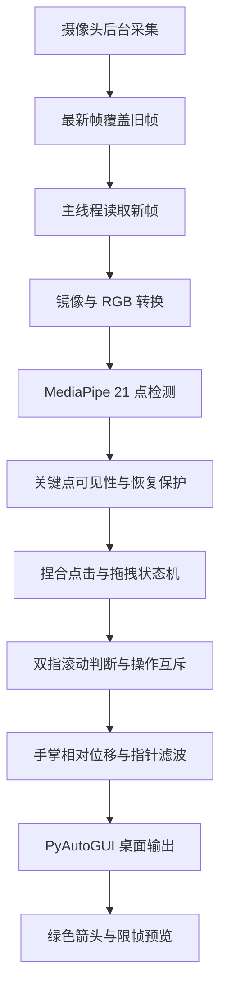

# OpenCV 手势鼠标｜基于手部关键点的非接触式电脑交互系统

基于 **Python + OpenCV + MediaPipe + NumPy** 的非接触式鼠标项目。使用普通电脑摄像头识别一只手，通过手部关键点控制 Linux X11 桌面的鼠标移动、左右键单击、左键双击、拖拽和网页上下滚动。

项目围绕完整的交互流程实现：手部检测 → 手势判断 → 操作互斥 → 指针防抖 → 系统鼠标输出，并提供绿色大箭头、全局快捷键、摄像头预览和输出计数，方便学习、调试和现场演示。

**当前功能阶段：2.0（完整鼠标交互）。** 1.0、2.0 的功能边界与开发顺序见下文版本说明。

**启动后默认暂停，按 F8 才开始控制。** 修改代码后需要退出旧进程，再重新启动。

## 目录

- [项目背景与目标](#项目背景与目标)
- [版本演进](#版本演进)
- [功能实现顺序](#功能实现顺序)
- [功能与手势速查](#功能与手势速查)
- [运行环境与技术栈](#运行环境与技术栈)
- [安装与启动](#安装与启动)
- [操作方法](#操作方法)
- [快捷键与调节](#快捷键与调节)
- [预览窗口怎么看](#预览窗口怎么看)
- [实现原理](#实现原理)
- [参数说明](#参数说明)
- [源码结构与阅读顺序](#源码结构与阅读顺序)
- [验证与演示](#验证与演示)
- [开发问题与解决方法](#开发问题与解决方法)
- [常见问题](#常见问题)
- [仓库访问与项目分享](#仓库访问与项目分享)
- [第三方组件与许可说明](#第三方组件与许可说明)
- [当前边界与后续方向](#当前边界与后续方向)

## 项目背景与目标

普通鼠标依靠手持设备输入。本项目使用普通 RGB 摄像头获取手部动作，将视觉识别结果转换为桌面鼠标事件，用于计算机视觉学习、非接触交互演示和桌面操作实验。

项目目标是让用户能完成“移动到目标 → 单击选中 → 双击打开 → 右键菜单 → 拖动 → 浏览长网页”的实际操作流程，并能通过界面提示判断当前识别与输出状态。项目不需要深度摄像头、手套或自行训练手部模型。

### 项目定位

| 项目项 | 说明 |
| --- | --- |
| 输入 | 普通摄像头中的单手图像 |
| 感知 | 预训练 MediaPipe HandLandmarker，检测 21 个关键点 |
| 交互逻辑 | 规则判断、捏合状态机、操作互斥、相对位移与滤波 |
| 输出 | Linux X11 桌面的鼠标移动、点击、拖拽和滚轮事件 |
| 典型演示 | 文件夹选择与打开、窗口拖动、文字选择、网页浏览 |
| 完成范围 | 基础鼠标操作及跟踪中断保护，本机交互验证 |
| 尚未完成 | 跨平台适配、跨使用者准确率评测、个性化配置持久化 |

OpenCV 负责图像采集与显示；MediaPipe 提供手部关键点；本项目代码在这些关键点之上实现手势到桌面操作的转换。当前使用预训练模型，没有自行训练手部检测模型，也不把它描述为自研识别网络。

## 版本演进

这里按实际提交记录将开发成果整理为 **1.0 基础交互阶段** 和 **2.0 完整交互阶段**。版本号用于说明功能演进；目前未创建对应 Git 标签或 GitHub Release，不代表已经发布了两个可下载的发行包。默认分支保存当前 2.0 阶段代码，旧版通过历史提交查看。

### 1.0：基础识别与左右键交互

**阶段记录：2026-10-22。** 目标是打通“摄像头 → 手部关键点 → 鼠标移动与单击”的最小流程。

实现内容：

1. 搭建 Python 虚拟环境，安装 OpenCV、MediaPipe、NumPy 和 PyAutoGUI。
2. 获取摄像头画面，镜像显示并绘制 21 个手部关键点。
3. 将食指指尖位置映射到屏幕，使用固定系数的指数平滑减轻抖动。
4. 根据拇指与目标指尖距离相对掌宽的比例，识别左右键捏合。
5. 加入张开准备、捏合确认、松开输出与冷却逻辑，捏合过程中锁住指针。
6. 默认暂停，通过预览窗口内的键盘按键开始、暂停和退出；手丢失后取消待触发动作。

**旧版操作与现版不同：** 1.0 使用画面中央约 70% 的区域进行指尖绝对映射；拇指＋中指为左击，拇指＋食指为右击。当前 2.0 已改成相对移动并交换左右键对应手指，请以本 README 的当前手势表为准。

这一阶段能展示移动、文件选中和右键菜单；没有专用双击、拖拽或网页滚动。固定区域、指尖位移和固定平滑系数，在瞄准、收指与长距离移动时仍存在体验问题。

历史源码与说明：[1.0 阶段快照 f54fd2a](https://github.com/cisyam555/opencv-gesture-mouse/tree/f54fd2ab78ab04c0105eacde892ad9d824d8d637)。该快照保留当时的文件结构、手势和测试说明，不能直接套用现版模块路径。

### 2.0：完整鼠标交互与稳定性优化

**功能集中提交：2026-10-23；文档继续整理于 2026-10-24。** 目标是补齐双击、拖拽和网页滚动，并改善移动与手势切换体验。

实现内容：

1. 移动改为掌部参考点的相对位移；食指伸出允许移动，收起停止，重新伸出后从当前光标位置继续。
2. 增加慢移瞄准、快移跨屏、自适应平滑、悬停锚点和收指瞬间保护。
3. 调整当前左右键手势，新增无名指捏合左键双击。
4. 新增小指长捏拖拽，松开放下，支持窗口拖动、文件拖动、框选与文字选择。
5. 新增双指滚动：轻推选方向，保持姿势持续滚动，退出姿势停止。
6. 通过手指独立准备和输入互斥，处理点击、双击、滚动、拖拽之间的冲突。
7. 增加固定绿色大箭头和全局 F8 / F9 / F10，缩小预览并允许隐藏。
8. 使用后台最新帧采集、预览限帧和分阶段耗时统计，减少积压并帮助定位性能瓶颈。
9. 按动作检查必要关键点，允许部分非必要点出画；跟踪丢失、暂停或退出时释放拖拽。
10. 将源码拆分为采集、控制和桌面辅助模块，移除旧版平铺脚本及独立测试程序。

功能源码快照：[2.0 阶段功能提交 580ec68](https://github.com/cisyam555/opencv-gesture-mouse/tree/580ec681bc85fa4e966ec6fe64d219d110ef7c15)。安装和演示推荐使用当前默认分支。

### 版本对照

| 对比项 | 1.0 基础交互 | 2.0 当前交互 |
| --- | --- | --- |
| 手部检测 | 单手 21 点 | 保留，并按操作检查必要点 |
| 鼠标移动 | 食指指尖绝对映射、中央区域 | 掌部相对位移，无固定操作框 |
| 停住与恢复 | 主要依赖暂停、锁位 | 收食指停止，重新伸指继续 |
| 防抖 | 固定指数平滑 | 自适应滤波、死区与悬停锚点 |
| 左键 / 右键 | 中指 / 食指与拇指捏合 | 食指 / 中指与拇指捏合 |
| 专用左键双击 | 无 | 无名指与拇指捏合 |
| 拖拽 / 框选 / 文字选择 | 无 | 小指长捏按住，松开释放 |
| 网页上下滚动 | 无 | 双指轻推选方向，保持持续滚动 |
| 全局快捷键 | 无，需预览窗口焦点 | F8、F9、F10 |
| 指针辅助 | 系统光标 | 额外显示绿色大箭头 |
| 采集方式 | 主循环采集与处理 | 后台采集，只交付最新帧 |
| 源码组织 | 主程序与独立手势文件 | `control/` 与 `desktop/` 模块划分 |

## 功能实现顺序

下面按功能依赖整理实现路线，便于从零复现和验收讲解。2.0 的多项改动集中在一个功能提交中，本表不是逐项独立发布记录。

| 顺序 | 阶段 | 实现内容 | 当前对应源码 | 完成后怎样验证 |
| --- | --- | --- | --- | --- |
| 1 | 1.0 | 环境、依赖和模型准备 | `opencv/requirements.txt`、模型目录 | 能导入依赖并成功加载模型 |
| 2 | 1.0 | 摄像头读取、镜像和颜色转换 | `gesture_mouse/app.py` | 画面显示正常，左右方向符合预期 |
| 3 | 1.0 | 手部 21 点检测与骨架绘制 | `app.py`、`desktop/preview.py` | 指尖与关节标记随手移动 |
| 4 | 1.0 | 指尖坐标到屏幕映射、初步平滑 | 旧版 `opencv/main.py` | 能把指针移到指定文件上 |
| 5 | 1.0 | 左右键、松开触发、防重复 | 现版 `control/gestures.py` | 一次捏合松开只发送一次点击 |
| 6 | 2.0 | 掌部相对移动、收指停止和恢复 | `control/pointer.py` | 收指调整手的位置后能继续移动 |
| 7 | 2.0 | 自适应防抖、悬停和点击锁位 | `pointer.py`、`gestures.py` | 停稳与点击时落点偏移减少 |
| 8 | 2.0 | 无名指双击与桌面事件输出 | `gestures.py`、`desktop/mouse.py` | 一次手势双击打开文件夹 |
| 9 | 2.0 | 小指长捏拖拽与可靠释放 | `gestures.py`、`mouse.py` | 窗口能拖动，松开或暂停后放下 |
| 10 | 2.0 | 双指上下滚动与模式互斥 | `control/scroll.py`、`app.py` | 网页上下滚动，收中指停止 |
| 11 | 2.0 | 绿色箭头、快捷键、小窗与隐藏 | `desktop/cursor.py`、`hotkeys.py`、`preview.py` | 切到浏览器后仍可暂停与退出 |
| 12 | 2.0 | 最新帧采集、耗时与输出计数 | `camera.py`、`app.py`、`preview.py` | 可区分识别耗时、采集速度与动作输出 |
| 13 | 2.0 | 出画保护、模块整理与文档 | `control/tracking.py`、各模块 | 丢手停止，恢复无补发点击，按文档可复现 |

表中 `gesture_mouse/` 以下文件均位于 `opencv/gesture_mouse/`。第 4 步是历史实现；当前使用第 6、7 步的相对控制方案，旧版移动代码已不保留在工作目录。

## 功能与手势速查

| 功能 | 手势 / 操作 | 行为 |
| --- | --- | --- |
| 鼠标移动 | 伸出食指，移动手掌 | 相对移动；慢移用于瞄准，快移用于跨屏 |
| 停住指针 | 收起食指 | 停止移动；重新伸指后从当前指针位置继续 |
| 左键单击 | 拇指＋食指捏合，再松开 | 松开后发送一次左击 |
| 右键单击 | 拇指＋中指捏合，再松开 | 松开后发送一次右击 |
| 左键双击 | 拇指＋无名指捏合，再松开 | 程序发送两次左击，无需连续做两次手势 |
| 开始拖拽 | 拇指＋小指捏合并保持约 0.30 秒 | 出现 `DRAGGING` 后按住左键 |
| 持续拖动 | 保持小指捏合并移动手掌 | 食指可以自然弯曲 |
| 放下目标 | 松开小指捏合 | 释放左键，不补发单击 |
| 滚动准备 | 食指、中指伸出，略微分开；无名指、小指自然弯曲 | 保持约 0.16 秒进入滚动 |
| 网页向下滚动 | 两个指尖向下移动一点，再保持双指姿势 | 持续发送向下滚轮事件 |
| 网页向上滚动 | 两个指尖向上移动一点，再保持双指姿势 | 持续发送向上滚轮事件 |
| 停止滚动 | 收起中指，或离开双指姿势 | 停止滚轮；下一次进入需重新轻推选方向 |
| 开始 / 暂停 | F8 | 全局切换，暂停时释放拖拽 |
| 显示 / 隐藏预览 | F9 | 摄像头继续采集和识别 |
| 退出 | F10 | 结束程序并清理资源 |

> 捏合前，先让对应手指与拇指分开一下。每根手指独立经历“张开准备 → 捏合确认 → 松开输出”，用于减少自然蜷指造成的误触。

## 运行环境与技术栈

当前开发和验证环境为 **Linux X11、Python 3.12、单摄像头、单手输入**。请在已登录图形桌面的终端中运行。

检查桌面会话：

```bash
echo "$XDG_SESSION_TYPE"
```

本项目的全局按键和绿色箭头依赖 X11；当前预期输出为 `x11`。Wayland、Windows、macOS 和多显示器未完成适配验证。

| 技术 | 在本项目中的职责 |
| --- | --- |
| OpenCV | 采集摄像头、镜像画面、BGR/RGB 转换、骨架和状态绘制、预览窗口 |
| MediaPipe Tasks HandLandmarker | 检测单只手的 21 个关键点，使用 VIDEO 模式连续跟踪 |
| NumPy | 关键点坐标转换、距离和掌宽比例计算 |
| PyAutoGUI | 获取桌面指针位置，输出移动、按键、双击和滚轮 |
| Python-Xlib / X11 Shape | 全局快捷键、置顶箭头窗口、点击穿透 |
| threading.Condition | 协调后台摄像头采集与主线程识别，只交付最新帧 |

依赖版本以 [opencv/requirements.txt](opencv/requirements.txt) 为准。项目使用 **`opencv-contrib-python`**，不要在同一环境混装 `opencv-python`、headless 等多个 OpenCV 发行包。

## 安装与启动

### 1. 获取项目

```bash
git clone https://github.com/cisyam555/opencv-gesture-mouse.git
cd opencv-gesture-mouse
```

如果仓库是私有仓库，需要使用有访问权限的 GitHub 账号认证。已配置 SSH 密钥时也可使用：

```bash
git clone git@github.com:cisyam555/opencv-gesture-mouse.git
```

### 2. 创建独立环境并安装依赖

下面从项目根目录进入 `opencv/`：

```bash
cd opencv
python3 -m venv .venv
source .venv/bin/activate
python -m pip install --upgrade pip
python -m pip install -r requirements.txt
```

Ubuntu / Debian 如果缺少 venv 或 Tk 支持，可以先安装系统组件，再执行上面的步骤：

```bash
sudo apt install python3-venv python3-tk
```

### 3. 下载手部关键点模型

仍在 `opencv/` 目录中执行：

```bash
mkdir -p models
curl -L --fail \
  "https://storage.googleapis.com/mediapipe-models/hand_landmarker/hand_landmarker/float16/1/hand_landmarker.task" \
  -o models/hand_landmarker.task
```

模型应位于：

```text
opencv/models/hand_landmarker.task
```

程序按源码位置查找模型，不依赖终端当前目录。模型未随 Git 提交；首次下载和安装需要联网，运行期间的摄像头识别在本地进行，不录制或上传画面。

### 4. 运行

```bash
python main.py
```

以后再次启动，只需在 `opencv/` 目录执行：

```bash
source .venv/bin/activate
python main.py
```

也可以从仓库根目录运行：

```bash
opencv/.venv/bin/python opencv/main.py
```

看到预览窗口后，先确认手部骨架能跟随，再按 **F8**。同一时间只运行一个实例，避免争抢摄像头或快捷键。

## 操作方法

### 移动、瞄准与停住

伸出食指作为移动开关，移动手掌控制指针。位移取食指根部关键点，不直接把指尖位置映射成屏幕位置，减少手指弯曲时带动鼠标。

这是相对控制：不需要把手移到摄像头画面边缘才能到达屏幕边缘。手移动到不舒服的位置时，可以收起食指、把手移回舒适位置，再伸指继续，相当于抬起实体鼠标重新摆放。

慢速、小幅移动使用较低增益以便瞄准；快速移动使用较高增益。手掌在小范围内稳定约 0.45 秒后进入悬停锁定，明确移动后自动解除。开始收指的预判保护最多持续 0.12 秒，避免姿势变化后一直无法移动。

建议前臂或肘部靠在桌上，保持摄像头能看到食指和掌部必要关键点。程序使用完整画面，没有蓝框内活动区限制；靠近边缘的橙色提示本身不禁止控制。

### 左击、右击与双击

1. 把指针移到目标上。
2. 先将目标手指与拇指分开一下。
3. 捏合对应指尖，短暂停留，再松开。
4. 观察 `LEFT CLICK`、`RIGHT CLICK` 或 `LEFT DOUBLE CLICK` 反馈。

单击和双击都在**松开后输出**。进入捏合时冻结指针，点击后再保留约 0.14 秒的开指保护，然后重新建立手掌移动基准，减少点击落点跳动。

双击时食指、中指可以伸出。只要无名指先张开准备，再主动与拇指捏合，点击判断就会优先处理，不需要为了双击强行收起其他手指。多个已准备的捏合同时出现时，本次操作会取消，避免同时触发两种动作。

### 拖拽、框选和文字选择

1. 将指针移到窗口标题栏、文件、空白区域或文本选择起点。
2. 拇指与小指捏合，保持约 0.30 秒。
3. 出现 `DRAGGING` 后移动手掌。
4. 松开小指捏合，释放左键并放下目标。

`DRAG READY` 仅表示准备中，不能当作已经按下。小指短捏不产生普通单击；其他三种捏合长按也不会自动变成拖拽。

拖拽期间食指可以弯曲，其他手指不会切换成点击或滚动。暂停、退出、手丢失或拖拽必要关键点出画时会释放左键；恢复识别后需重新张开、捏合，不会自动恢复按住。

### 网页上下滚动

1. 打开有足够长度的网页，将指针放在**网页正文区域**，让浏览器获得焦点。
2. 伸出食指、中指，略微分开；无名指、小指自然向掌心弯曲。
3. 保持约 0.16 秒，观察 `SCROLL READY` / `SCROLL`。
4. 两个指尖**向下移一点后保持**，持续向下滚动；**向上移一点后保持**，持续向上滚动。
5. 收起中指停止。再次进入时重新轻推选方向。

方向输入使用两个指尖的中点。手掌可以基本不动，也可以让整只手带着两指一起上下移动。不需要反复挥手，也不需要回到某个中心点。

拇指可以自然放松或收在掌边，不要捏住食指、中指。未张开准备的无名指、小指自然靠近拇指，不会单独阻挡滚动；主动张开再捏合仍优先触发点击或拖拽。

程序沿食指、中指的朝向判断其他手指是伸出还是向下弯曲，避免把朝下弯曲的指尖误判为伸直。手腕、拇指和弯曲指尖在画面下缘出画，不单独阻止滚动；食指、中指及掌宽必要点仍须在画面内。拇指出画时不允许点击。

这是普通滚轮滚动，不是一次跳过整页。先验证向下滚，并观察 `WHEEL SENT` 的 `DOWN` 是否增加；如果网页已经在顶部，继续向上滚动通常看不到变化。

## 快捷键与调节

| 按键 | 作用 | 使用范围 |
| --- | --- | --- |
| F8 | 开始 / 暂停，暂停时释放拖拽 | 全局 |
| F9 | 隐藏 / 显示预览，保持摄像头和识别运行 | 全局 |
| F10 | 退出并清理资源 | 全局 |
| s | 开始 / 暂停 | 预览窗口获得焦点时 |
| q / Esc | 退出 | 预览窗口获得焦点时 |
| h | 切换预览显示 | 预览窗口获得焦点时 |
| + / = | 提高指针跟随响应，每次增加 0.2 | 预览窗口获得焦点时 |
| - | 降低指针跟随响应，每次减少 0.2 | 预览窗口获得焦点时 |
| ] / [ | 提高 / 降低滚动速度，每次 1 格/秒 | 预览窗口获得焦点时 |

指针响应调节范围为 0.4～2.5，默认 1.35；滚动目标速度范围为每秒 2～12 格，默认 6 格。调节只对本次运行有效，实际滚轮输出频率也受处理帧率影响。

部分笔记本需要 **Fn＋F8/F9/F10**。全局按键注册失败时，程序会保留预览窗口，以便使用本地按键退出。

F9 只隐藏画面，**不会暂停控制**。隐藏后跳过骨架、文字、画面绘制及窗口键盘事件处理，绿色箭头和全局按键仍可用；实际提速取决于摄像头与模型耗时，不能保证隐藏后明显变快。

## 预览窗口怎么看

| 提示 / 字段 | 含义 | 建议 |
| --- | --- | --- |
| `PAUSED` / `ACTIVE` | 暂停 / 允许输出操作 | F8 切换 |
| `OPEN` | 所选手指还未张开准备 | 先分开对应指尖和拇指 |
| `READY` | 对应手指已准备 | 可以开始捏合 |
| `PINCH` | 捏合确认中 | 短暂停留 |
| `CONFIRMED` | 捏合确认完成 | 松开输出单击或双击 |
| `DRAG READY` | 等待小指长捏 | 保持到 `DRAGGING` 后再拖 |
| `DRAGGING` | 左键已经按住 | 松开小指放下 |
| `CANCEL` | 本次手势被取消 | 根据后面的原因重新准备 |
| `HOLD: stable pointer` | 悬停锁定 | 明确移动手掌解除 |
| `SCROLL READY` | 双指滚动准备中 | 保持姿势片刻 |
| `SCROLL UP/DOWN` | 已选定持续滚动方向 | 收中指停止 |
| `Lift INDEX/MIDDLE fingertip` | 对应指尖未满足伸出条件 | 自然伸出对应手指 |
| `Relax/fold RING/LITTLE finger` | 无名指 / 小指被判定为伸出 | 自然向掌心弯曲 |
| `Release INDEX/MIDDLE pinch` | 拇指过于靠近食指 / 中指 | 松开对应捏合 |
| `Show INDEX and MIDDLE joints` | 双指关节方向不清晰 | 调整手掌朝向 |
| `INDEX/PALM OUT` | 食指或掌宽必要点出画 | 将手移回画面内 |
| `PARTIAL HAND` | 部分非必要点出画 | 必要点可见时仍可操作 |
| `RECOVERING` | 重获跟踪的稳定等待期 | 短暂保持稳定 |
| `HAND LOST` | 没有检测到手 | 将手移回画面 |
| `FPS` | 主循环处理帧率 | 用于观察实际处理速度 |
| `Camera` | 后台实测采集帧率 | 与请求的 30 FPS 区分 |
| `MOVE calls` | 已发送的指针移动次数 | 判断是否有移动输出 |
| `L/R/D/G` | 四种捏合距离与掌宽之比 | 分别对应左击、右击、双击、拖拽 |
| `SENT` | 点击、双击、拖拽开始次数 | 确认动作是否输出 |
| `WHEEL SENT: UP/DOWN` | 已输出的上滚 / 下滚格数 | 判断滚动是否触发 |
| `app wait` | 帧到达应用后，到交给识别前的等待时间 | 不代表端到端延迟 |

输出计数只表示程序调用了鼠标后端，不保证目标软件一定执行了预期操作。终端不逐次打印点击坐标，只保留异常、运行提示和退出时的耗时统计。

`ms avg` 使用近期滑动平均，单位为毫秒：

| 字段 | 统计范围 |
| --- | --- |
| `cam` | 主线程等待 / 取得最新帧 |
| `detect` | 镜像、颜色转换、模型输入构造和关键点识别 |
| `ctrl` | 跟踪保护、手势判断、鼠标输出、箭头更新 |
| `ui` | 预览绘制、窗口事件和快捷键处理等循环尾部工作 |

## 实现原理

### 1. 主流程



### 2. 最新帧采集

后台线程持续读取摄像头，只保存一张最新画面。新帧覆盖旧帧，主线程通过条件变量等待尚未消费的新帧，不重复识别同一帧，不建立旧帧队列。

模型使用 VIDEO 模式，时间戳取该帧被应用收到的单调时钟时间，并保证严格递增。采集线程独占摄像头的 `read/release`，避免主线程释放摄像头时与后台读取发生竞态。

程序请求 640×480、30 FPS，并尝试把驱动缓冲设为 1；驱动可能忽略这些设置。最新帧策略减少应用积压，无法消除曝光时间、USB 传输和驱动内部延迟。

### 3. 捏合状态机与互斥

以关键点 5 到 17 的距离作为掌宽，捏合距离按掌宽归一化，减少手与摄像头距离变化的影响：

```text
左击距离 = distance(4, 8) / 掌宽
右击距离 = distance(4, 12) / 掌宽
双击距离 = distance(4, 16) / 掌宽
拖拽距离 = distance(4, 20) / 掌宽
```

每根手指独立准备，进入捏合和退出捏合使用不同阈值，减少临界距离抖动。多个已准备的捏合同时出现会取消本次操作。点击准备、确认、释放阶段冻结指针；拖拽开始后只检查小指保持状态及跟踪保护，不切换成其他动作。

滚动期间继续更新各指准备状态。主动捏合优先于滚动，防止“食指、中指仍然伸出时，无名指双击被 V 手势吞掉”。自然收起、未准备的无名指和小指不会单凭靠近拇指就触发动作。

### 4. 指针稳定与响应

普通移动使用食指作开关，位移来自食指根部关键点 5。输入经过微小位移死区、随速度变化的增益和按时间计算的自适应滤波。快速移动提高响应，慢速移动保留精细操作能力。

悬停使用固定锚点，避免微小噪声不断累积成漂移；从悬停、收指或点击恢复时重新建立移动基准，减少跳动。横向、纵向位移缩放系数用于计算灵敏度，不是摄像头裁剪框。

### 5. 绿色箭头与安全释放

X11 创建固定绿色、白边的大箭头，尖端对齐系统指针位置。窗口使用 Shape 扩展设置透明外形与空输入区域，允许点击穿透，不抢走目标软件的鼠标输入。箭头采用批量绘制，减少逐行 X11 请求。

手丢失、必要点出画、手掌过小、暂停、退出或异常时，会执行拖拽释放。摄像头新帧等待超过 0.5 秒，或帧在应用中滞留超过 0.2 秒，会停止控制并进入清理流程。PyAutoGUI 的屏幕角落安全停止保持开启；释放按键时仅临时绕过该保护，完成后恢复。

## 参数说明

参数目前直接定义在源码中，没有额外配置界面。以代码为最终依据，修改后重启生效。

| 参数 | 当前值 | 所在文件 | 作用 |
| --- | --- | --- | --- |
| 摄像头请求 | 640×480 / 30 FPS | `gesture_mouse/app.py` | 期望采集参数，实际取决于驱动 |
| 检测 / 存在 / 跟踪置信度 | 各 0.6 | `gesture_mouse/app.py` | MediaPipe 检测设置 |
| 预览刷新上限 | 12 FPS | `desktop/preview.py` | 只限制预览，不限制识别 |
| 张开准备 | 0.06 秒 | `control/gestures.py` | 对应手指准备下一次操作 |
| 捏合进入 / 退出 | 0.36 / 0.46 掌宽 | `control/gestures.py` | 带迟滞的捏合判断 |
| 普通捏合确认 / 松开确认 | 各 0.04 秒 | `control/gestures.py` | 排除过短接触与松开抖动 |
| 接近捏合的预冻结 | 距离小于 0.44 掌宽，最多 0.12 秒 | `control/gestures.py` | 减少捏合前的落点偏移 |
| 点击冷却 / 点击后锁位 | 0.22 / 0.14 秒 | `control/gestures.py` | 减少重复动作和开指跳动 |
| 小指拖拽确认 | 0.30 秒 | `control/gestures.py` | 与短捏分开 |
| 未完成捏合的最长时间 | 1.80 秒 | `control/gestures.py` | 取消超时动作；不限制已开始的拖拽 |
| 指针响应默认值 | 1.35 | `control/pointer.py` | 可用 +/- 临时调节 |
| 稳定悬停时间 | 约 0.45 秒 | `control/pointer.py` | 小范围稳定后锁位 |
| 跟踪恢复等待 | 0.12 秒 | `control/tracking.py` | 重新入镜后的稳定期 |
| 最小掌宽 | 20 像素 | `app.py`、`control/` | 过小或严重侧掌时不输出 |
| 双指进入时间 | 0.16 秒 | `control/scroll.py` | 双指稳定后进入滚动 |
| 选方向的轻推距离 | 0.10 掌宽 | `control/scroll.py` | 两个指尖中点的上下位移 |
| 滚动目标速度 | 默认 6 格/秒 | `control/scroll.py` | 可用 [] 临时调节 |
| 滚动断帧保护 | 0.25 秒 | `control/scroll.py` | 中断后重新准备方向 |
| 摄像头等待 / 应用帧过旧阈值 | 0.5 / 0.2 秒 | `gesture_mouse/camera.py` | 断流或旧帧时停止控制 |

表中代码路径除 `gesture_mouse/` 外，以 `opencv/gesture_mouse/` 为起点。时间门槛按实际收到的帧判断，低帧率时会有一个或多个帧间隔的额外等待。

## 源码结构与阅读顺序

```text
opencv-gesture-mouse/
├── README.md                       # 完整项目说明
├── requirements.txt                # 转引 opencv/requirements.txt
├── .gitignore
└── opencv/
    ├── main.py                     # 唯一启动入口
    ├── README.md                   # 简明启动与阅读指南
    ├── requirements.txt            # 第三方依赖版本
    ├── models/
    │   └── hand_landmarker.task    # 本地下载，不提交
    └── gesture_mouse/
        ├── __init__.py
        ├── app.py                  # 采集、识别、互斥、输出和显示的主流程
        ├── camera.py               # 后台最新帧采集与超时保护
        ├── control/
        │   ├── __init__.py
        │   ├── gestures.py         # 捏合点击、双击、小指拖拽
        │   ├── pointer.py          # 相对移动、收指保护、悬停与滤波
        │   ├── scroll.py           # 双指姿势、方向选择与持续滚动
        │   └── tracking.py         # 必要点可见性与稳定恢复
        └── desktop/
            ├── __init__.py
            ├── mouse.py            # 系统鼠标动作与拖拽释放
            ├── preview.py          # 骨架、状态、计数和耗时显示
            ├── hotkeys.py          # X11 全局 F8 / F9 / F10
            ├── cursor.py           # 固定绿色箭头
            └── x11_shape.py        # Xlib Shape 点击穿透兼容
```

建议按 `main.py → app.py → control/gestures.py → control/pointer.py → control/scroll.py` 的顺序阅读，再看 `camera.py` 和 `desktop/`。

项目只保留当前包结构，没有旧版平铺脚本或独立测试软件；虚拟环境、模型、运行缓存均由 `.gitignore` 排除。

## 验证与演示

以下步骤适合现场逐项演示。先确认图形会话为 X11，光线充足，摄像头能看到必要关键点，再按 F8。

| 顺序 | 操作 | 观察结果 |
| --- | --- | --- |
| 1 | 伸食指移动，再收指 | 指针跟随并停止，`MOVE calls` 增加 |
| 2 | 指针停在文件夹上，食指捏合松开 | 文件夹被选中，`L` 增加 |
| 3 | 中指捏合松开 | 显示右键菜单，`R` 增加 |
| 4 | 关闭菜单，无名指捏合松开 | 在双击打开的文件管理器中打开文件夹，`D` 增加 |
| 5 | 指向普通窗口标题栏，小指长捏并移动 | 出现 `DRAGGING`，窗口跟随 |
| 6 | 松开小指 | 窗口停下，不追加单击 |
| 7 | 在空白区域或文本上拖动 | 产生框选或文字选择 |
| 8 | 长网页正文区域摆双指，先向下轻推 | `DOWN` 增加，正文向下滚动 |
| 9 | 双指向上轻推，再收中指 | `UP` 增加，然后停止滚动 |
| 10 | 拖拽时按 F8，或让手离开画面 | 左键释放，不自动恢复拖动 |
| 11 | F9 隐藏后按 F8 / F9 | 仍能暂停和恢复预览 |
| 12 | F10 退出 | 摄像头、箭头、快捷键及拖拽按键得到清理 |

开发期间使用临时模拟脚本验证过点击状态机、上下滚动、双指到双击的切换、下缘部分出画、收指恢复、摄像头最新帧覆盖、断流和退出清理。X11 独立窗口验证过滚轮按钮 4 / 5 的实际接收。

当前功能已实现并用于本机手动验证；以上检查不是不同使用者、光照和设备下的识别准确率评测。仓库没有保存额外的测试程序文件。

### 可重复的效果评估

功能演示通过不等于准确率已经达到某个数值。需要量化时，固定摄像头位置、光照、目标尺寸和浏览器缩放，记录环境与每次结果；不同使用者分别统计，不把某一次成功当作总体结论。

| 指标 | 建议记录方法 | 结果 |
| --- | --- | --- |
| 单击成功率 | 对固定目标做 20 次左击，正确选中次数 / 20 | 待测 |
| 右击成功率 | 对同一目标做 20 次右击，正确弹出菜单次数 / 20 | 待测 |
| 双击成功率 | 关闭菜单后做 20 次双击，正确打开文件夹次数 / 20 | 待测 |
| 拖拽成功率 | 同一窗口拖到指定区域 10 次，成功放下次数 / 10 | 待测 |
| 误触次数 | 普通移动 60 秒，统计非预期点击和滚动 | 待测 |
| 滚动可控性 | 向下、停止、向上、停止，各做 10 次 | 待测 |
| 中断保护 | 拖拽中移出手或按 F8，核对释放结果 | 待测 |
| 性能 | 记录实测采集帧率、处理帧率及分阶段耗时 | 以运行时统计为准 |

这些是建议评估项目，不是已完成的测量报告。当前不提供未经测量的准确率或端到端延迟承诺。

### 验收讲解顺序

1. 说明项目目的、运行环境，以及 OpenCV 与 MediaPipe 的职责。
2. 展示 1.0 到 2.0 的功能差异，解释为什么从指尖绝对映射改成掌部相对移动。
3. 按上面的演示表完成选中、右击、双击、拖动和网页滚动。
4. 打开 `app.py` 讲一帧处理流程，再讲 `gestures.py` 状态机与 `pointer.py` 防抖。
5. 用 `camera.py` 解释最新帧策略，区分帧率、应用等待和完整响应延迟。
6. 展示手离开画面时停止输出，并说明光照、遮挡、疲劳与平台适配的限制。

## 开发问题与解决方法

| 现象 | 排查重点 | 当前处理方法 | 验证方式 |
| --- | --- | --- | --- |
| 鼠标漂移、目标难停稳 | 关键点噪声累积、平滑尾随 | 小位移死区、稳定悬停锚点、自适应滤波 | 指向同一目标保持，观察是否持续偏离 |
| 收起食指时光标跳动 | 指尖弯曲被当成移动 | 改用食指根部相对位移、收指预判、重建移动基准 | 连续伸指、收指、调整手位 |
| 点击时光标离开文件 | 捏合过程带动移动参考点 | 捏合准备及点击期间锁位，松开后短暂保护 | 在同一文件上反复单击并核对落点 |
| 一次捏合重复点击 | 按帧触发、边界距离波动 | 张开准备、确认与释放状态、双阈值、冷却 | 长捏和松开后观察输出次数 |
| 双击被双指姿势拦截 | 食指、中指伸出时满足滚动候选 | 手指独立准备，主动捏合优先，滚动互斥 | 保持食指中指伸出，再做无名指双击 |
| 网页不滚，只有指针动 | 未进入滚动或姿势条件不满足 | 姿势诊断提示，进入延时，双指中点轻推选方向 | 看 `SCROLL` 原因及 `UP/DOWN` 计数 |
| 滚轮计数增加但页面不动 | 指针在预览窗口或页面已到边界 | 将指针放正文，确认焦点和可滚动内容 | 长网页中段分别验证上下滚动 |
| 手指向下弯却被当作伸直 | 单纯距离不能区分伸展方向 | 沿食指、中指方向计算指尖前向投影 | 自然弯无名指、小指时验证双指进入 |
| 手靠近画面边缘就停 | 对整手入镜要求过严 | 按操作检查必要点，边缘提示与禁止输出分开 | 非必要点出画时验证允许的动作 |
| 预览隐藏后仍感觉迟缓 | 采集与推理是主要瓶颈 | 最新帧覆盖、预览限帧、分阶段统计 | 对比 `Camera`、`detect` 与 `ui` |
| 绿色箭头挡住点击 | 辅助窗口截获输入 | X11 Shape 设置空输入区域，允许穿透 | 对箭头指向的文件执行单击 |
| 拖拽后手出画仍可能按住 | 按下与释放未配对 | 统一输出封装，暂停、丢手、异常与退出清理 | 拖拽中移出手并确认左键释放 |

这些改动针对开发中观察到的问题，不意味着已经消除所有误触。需要在具体设备、光照和使用者条件下复测。

## 常见问题

### 手在画面里，鼠标却不动

先确认显示 `ACTIVE`。普通移动需要食指伸出，食指及掌宽必要点可见；`HOLD`、`PINCH`、`DRAG READY`、`SCROLL` 分别代表不同的锁位或控制状态。

本程序不要求整只手始终完整入镜，但“检测到手”也不等于每个操作所需关键点都可靠。手掌太小、严重侧掌或必要点超出画面时，仍会停止对应操作。

### 网页不滚动，只有鼠标在动

观察 `SCROLL:` 的具体提示，再看 `WHEEL SENT`：

- `UP/DOWN` 都不增加：双指姿势、方向位移或操作互斥条件尚未满足。
- `DOWN` 增加但页面不动：检查指针是否位于浏览器正文，而不是预览窗口、地址栏或另一个滚动面板；也检查网页是否已到底。
- 只有 `UP` 增加：说明当前识别成上滚；先让两个指尖向下移动一点，验证 `DOWN`。网页在顶部时上滚没有明显效果。
- `DRAG READY`：当前识别成小指长捏准备。先松开相关手指，退出捏合，再重新摆双指姿势。

### 为什么自然弯曲的手指会影响滚动

伸指与弯指使用关键点的二维投影判断，遮挡和朝向变化仍可能造成误判。当前已按食指、中指方向判断其他指尖的前向伸出量，避免只比较“离掌心多远”导致向下弯指被识别为伸直。

### 双击和双指滚动会不会冲突

食指、中指伸出可以同时出现在两种操作中。程序会继续判断捏合状态：无名指先张开准备、再主动捏合松开时，优先输出双击；滚动要在没有进行中的点击或拖拽时才进入。

### 预览隐藏后为什么没有明显加速

隐藏主要减少绘制开销。如果摄像头采集或模型识别占用大部分时间，省下预览绘制并不会显著提高帧率。以 `Camera`、`FPS` 和 `ms avg` 判断，不要把请求 30 FPS 当作实际达到 30 FPS。

本机一次短时采集测试约为 16 FPS，识别处理约 15.7 FPS，应用内等待约 0.11 ms；这组数据只记录当时条件，不作为其他设备的性能保证。`app wait` 不包含曝光、驱动缓存和桌面响应，不能当作完整控制延迟。

### 修改代码后为什么表现没变化

正在运行的 Python 进程不会自动加载保存后的代码。先 F10 或 Ctrl+C 退出旧实例，再重新执行 `python main.py`。不要同时启动多个版本。

### 摄像头打不开或程序因画面超时停止

检查摄像头权限、其他程序是否占用设备、USB 连接和桌面会话。默认设备为 `VideoCapture(0)`，多个摄像头时可在 `app.py` 调整索引。程序遇到读取失败会停止并清理，处理原因后重新启动。

### GNOME 底部程序栏无法唤出

部分 Dock 要求在屏幕边缘施加“压力”，程序移动指针可能无法触发。程序不会自动修改系统设置。使用 Dash to Dock / Ubuntu Dock 且存在相应配置项时，可手动关闭该要求：

```bash
gsettings set org.gnome.shell.extensions.dash-to-dock require-pressure-to-show false
```

恢复：

```bash
gsettings set org.gnome.shell.extensions.dash-to-dock require-pressure-to-show true
```

## 仓库访问与项目分享

- 项目地址：<https://github.com/cisyam555/opencv-gesture-mouse>
- 作者主页：<https://github.com/cisyam555>
- 当前默认分支：`main`。

仓库存在但别人访问提示 **404 / Not Found** 时，先检查仓库名旁的可见性标记：

| 标记 | 访问范围 | 分享方法 |
| --- | --- | --- |
| `Private` | 所有者和已授权协作者 | 邀请指定 GitHub 用户为协作者，对方接受后登录访问 |
| `Public` | 所有人可浏览公开代码 | 直接分享项目链接，无需邀请 |

私有仓库不会因为分享链接自动开放访问，也通常不会出现在他人的公开搜索结果中。所有者登录后能看见、别人却看到 404，并不表示仓库被删除。网络连接失败、超时与 GitHub 的 404 页面应分开排查。

需要公开展示时，由所有者在 **Settings → General → Danger Zone → Change repository visibility** 中确认改为 Public。公开会暴露仓库代码及可访问的提交历史，历史版本也属于分享范围。如果只给老师验收，可以保持私有并在 **Settings → Collaborators** 邀请对方。

## 第三方组件与许可说明

本项目使用 OpenCV、MediaPipe、NumPy、PyAutoGUI 和 Python-Xlib 等第三方组件，手部模型从 MediaPipe 官方模型地址下载。组件与模型的使用、分发需遵守各自许可；模型文件不随本仓库提交。

当前仓库没有单独的 `LICENSE` 文件，本 README 不声明 MIT、Apache 等项目级授权。仓库公开可浏览与获得开源许可证授权是不同概念；如需复用或分发项目源码，应先明确授权范围。

## 当前边界与后续方向

当前完成鼠标交互闭环，实际效果仍受光照、遮挡、手势朝向、摄像头帧率及目标软件行为影响。二维单摄像头识别的精度和响应与实体鼠标存在差距。

当前版本没有实现专用 PPT 模式、按手势启动 / 关闭软件、音量控制、设置持久化、多人输入或专门的 Wayland 后端。后续可以在现有模块上增加个性化标定、配置文件和跨使用者效果评估。
